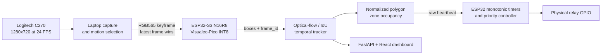

# Visualec

Visualec is a physical-hardware edge-vision controller for room energy management. A Logitech C270 supplies real frames to the laptop at 24 FPS. The laptop selects motion keyframes and sends them to an ESP32-S3 N16R8, where an INT8 one-class Visualec-Pico detector runs. The laptop tracks detections between edge results and computes raw polygon-zone occupancy; the ESP32 owns delays, manual overrides, emergency priority, relay GPIO, and fail-safe behavior.

There are no generated frames, simulated detections, simulated telemetry, or silent laptop-inference fallback. When the edge device is absent, inference is reported unavailable.

## Data and authority flow



Keyframes are sent at about 8 FPS during high motion, 4 FPS during medium motion, and 1 FPS during low motion, with a refresh at least once per second. The camera/tracker/zone loop still targets 24 Hz. This is a 24 FPS system-output target, not 24 neural inferences per second.

## Repository layout

```text
backend/                         FastAPI capture, edge protocol, tracking, zones, persistence
frontend/                        React dashboard and mouse-driven Zone Studio
firmware/visualec_edge_espidf/   ESP-IDF 5.3+ edge inference and relay controller
firmware/visualec_esp32_s3/      Arduino relay-only rollback image
ml/                              real-C270 capture, teacher labeling, student export/package
scripts/                         artifact verification, deployment, physical benchmark
docs/                            architecture, API, deployment, testing, wiring
```

## Run the host application

Requirements: Python 3.11–3.13, Node.js 20+, a physical C270, and the ESP32-S3 on the same local network.

```powershell
cd "D:\Program files\Visualec\backend"
python -m venv .venv
.venv\Scripts\Activate.ps1
pip install -r requirements.txt
Copy-Item .env.example .env
uvicorn app.main:app --reload
```

Set a long random `EDGE_DEVICE_TOKEN` in `backend/.env` and set the same value in ESP-IDF menuconfig. In another terminal:

```powershell
cd "D:\Program files\Visualec\frontend"
npm install
npm run dev
```

Open `http://localhost:5173`; OpenAPI is at `http://localhost:8000/docs`. The edge device connects to `ws://<laptop-ip>:8000/ws/edge?token=<token>`.

## Train and deploy the edge model

Follow [ml/README.md](ml/README.md). Only physical C270 sessions are accepted. YOLOv8n is the offline person-only teacher; it is never the production runtime detector. Packaging records hashes, real-data provenance, dimensions, quantization details, quality results, and tool versions. Deployment refuses an artifact that exceeds 1 MB, lacks real-frame provenance, retains under 90% teacher recall, loses over three mAP50 points after INT8 quantization, or fails SHA-256 verification.

The release image is in `firmware/visualec_edge_espidf`; build it using ESP-IDF 5.3+ after a verified `.espdl` exists. The Arduino firmware remains only as an acknowledged HTTP relay rollback image.

## Control semantics

Priority is fixed on the ESP32:

1. latched emergency stop
2. stale camera/link safe-off
3. temporary manual override
4. automatic raw occupancy

Activation and deactivation use monotonic device time and are applied exactly once. Manual OFF returns to automatic after the activation delay; manual ON returns after the deactivation delay. Missing occupancy freezes new ON decisions immediately and forces automatic relays OFF after the 30-second camera-loss timeout.

## Verification

```powershell
cd "D:\Program files\Visualec\backend"
pytest -q
cd ..\frontend
npm run build
```

Software tests validate the protocol, CRC, geometry restoration, tracking, revisions, and 15-event limit. Performance claims must be produced by `scripts/benchmark_edge.py` using the physical C270, physical N16R8, and recorded device packets. See the [testing guide](docs/testing-guide.md).

## Safety

Use low-voltage loads during development. Do not place mains voltage on a breadboard or exposed relay module. Mains installation requires a correctly rated enclosed relay/contactor assembly, protection, isolation, strain relief, and a qualified electrician.
