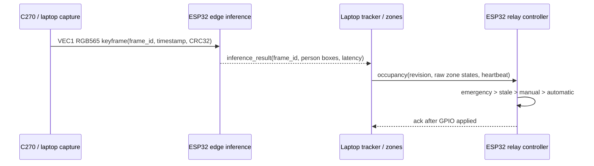

# Architecture

## Runtime ownership

The C270/laptop path owns capture, motion scoring, sparse keyframe transmission, temporal tracking, normalized polygon assignment, and dashboard presentation. The ESP32-S3 owns neural inference and all safety-critical control timing and GPIO. SQLite stores operator configuration and real event history; `RuntimeState` is the low-latency projection broadcast to the UI.

Only one inference frame may be outstanding. Newer keyframes replace queued stale frames, and late results are discarded by `frame_id`. Optical flow advances boxes between detector corrections; a track expires after 750 ms without valid flow or detector confirmation. Rising uncertainty requests an immediate keyframe.

## Wire protocol

`/ws/edge` is an authenticated, persistent device WebSocket. JSON messages cover `hello`, `config`, `occupancy`, `manual_override`, `emergency`, `ack`, `inference_result`, `metrics`, and `error`. Binary `VEC1` packets contain protocol version, pixel format, flags, frame ID, capture timestamp, 288×160 dimensions, payload length, RGB565 pixels, and CRC32.

The dashboard WebSocket remains `/ws`; existing REST APIs remain compatible and add edge status fields. Only the latest 15 real runtime events are exposed in live state.

## Device memory and tasks

The ESP-IDF application targets N16R8 at 240 MHz. Model parameters are flash-mapped from the dedicated model partition, frame/model buffers use 8 MB OPI PSRAM, and relay state plus hot workspace stays in internal SRAM. Two 3 MB OTA slots, NVS, OTA metadata, PHY data, a 2 MB model partition, and storage occupy the 16 MB flash layout.

Networking, inference, configuration/telemetry, and relay control use separate FreeRTOS tasks. Relay control runs at higher priority than inference and never performs WebSocket I/O in its timing loop.

## Failure policy

- No connected edge device means inference unavailable; there is no local or synthetic substitute.
- Bad CRC, dimensions, format, model hash, stale result, or configuration revision produces an explicit error or rejection.
- Missing occupancy freezes new ON decisions immediately; the existing 30-second timeout forces automatic outputs OFF.
- Emergency stop is persisted and latched until explicit reset.
- An acknowledgement is emitted only after GPIO is applied and reports requested/effective state, physical level, command ID, mode, and configuration revision.
